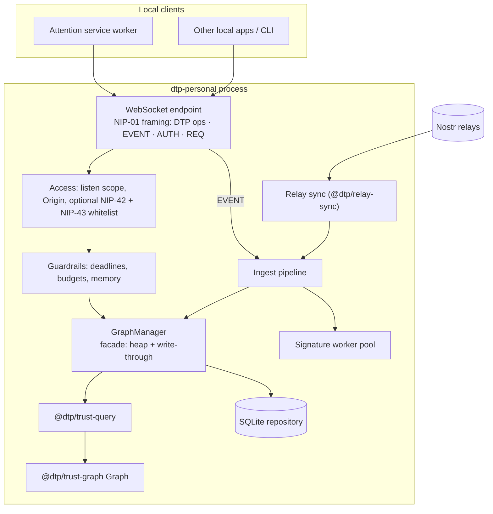

# Personal Server — architecture

Status: **draft** · 2026-09-30

## Purpose

A console app on the user's own machine (or local network) that holds one
WoT Graph heap, syncs it from Nostr relays, accepts the user's own signed
events, and answers the [resolver protocol](../../TrustGraph/specs/resolver-api.md)
exactly like the Global Server. The Attention extension's service worker no
longer has to hold and rebuild a large heap.

| Problem in the extension today | What the Personal Server changes |
| --- | --- |
| Service worker can die any time; every wake pays a heap rehydrate | Long-lived process; heap stays warm |
| Continuous sync needs a keep-warm alarm | Continuous sync is the default |
| Sync bounds are small (default depth 2, 150 authors) to protect the worker | Larger bounds, still bounded |
| One heap per Chrome profile | One heap for every local app and profile |

## Goals and non-goals

Goals:

- Same answers as the extension: the model is `@dtp/trust-graph`
  ([TrustGraph library.md](../../TrustGraph/specs/library.md)), not a copy.
- **Exactly the same API as the Global Server**, proven by the shared session
  suite ([TrustGraph conformance.md § One API](../../TrustGraph/specs/conformance.md#one-api-the-session-suite)).
  What differs is configuration and deployment only: it listens locally, its
  default `auth.writes = open` lets the extension send the user's own signed
  events, and it syncs from relays itself instead of being fed by Sync
  Servers.
- Query latency first: a 200-item batch answers from memory while sync runs.
- Minimal data: current slot winners only, as in the extension.

Non-goals:

- Holding or using a Nostr secret key.
- X identity or post data (`xIdentities`, `xPosts`), kind `0` profiles, own
  identity evidence. They stay in the extension.
- Relay delivery of the user's events. The extension's outbox publishes.
- Serving other people. That is the Global Server.
- Acting as a general Nostr relay or publishing NIP-85 assertions.

## Components

| Component | Role |
| --- | --- |
| WebSocket endpoint | One port, NIP-01 framing: resolver operations (`DTP`), ingest (`EVENT`), NIP-42 `AUTH`, limited `REQ`; NIP-11 and NIP-86 over HTTP on the same port (framework: decision PS-D3) |
| Access | Listen scope (this machine or LAN), `Host` and `Origin` checks, optional NIP-42 authentication against a NIP-43 membership list ([security.md](security.md)) |
| Guardrails | Per-operation deadlines, walk budgets, in-flight and output limits, memory budget (below) |
| GraphManager | Same role as the extension's `src/background/graphManager.ts`: the only thing that touches the heap; returns one payload per request |
| Ingest pipeline | Validate → eligibility (scope profile `x.com`) → slot reduction → store + heap in one pass; handles local NIP-09 removals |
| Signature worker pool | `worker_threads` running `@dtp/trust-protocol` verification in parallel |
| Relay sync | Port of the extension's `RelaySynchronizer` ([sync.md](sync.md)) |
| Repository | SQLite storage behind a port |
| Telemetry | Admin listener on `127.0.0.1:3871` serving the shared telemetry pages, JSON, and `/metrics` ([TrustGraph telemetry.md](../../TrustGraph/specs/telemetry.md)); in-memory ring buffers for 24 h of charts |

## Process model and CPU

- One Node.js process. The main thread owns the heap; the heap is a JS object
  graph and cannot be shared across threads.
- Queries are synchronous in-memory walks on the main thread. No database
  read happens on the query path (`REQ` by `ids` is the only reader).
- Ingest applies accepted winners in slices of at most ~5 ms, yielding to
  the event loop between slices, so queries never wait behind a sync burst.
- Signature verification runs in a worker pool sized `max(1, cores − 1)`.
- Event-loop lag is measured and exposed in `status`; sustained lag above
  50 ms is a bug.

## Lookups

Lookups ([wot-model.md §8.1](../../TrustGraph/specs/wot-model.md#81-lookups))
are one-degree reads, so they are served entirely by `@dtp/trust-query`
wrappers over the heap and never touch the locked walk:

| Lookup | Heap source |
| --- | --- |
| Incoming (32009 / 32014) | `Graph.in` over each key, the same calls `GraphManager.incomingRecords` makes today |
| Outgoing (32009 / 32014) | `Graph.out` over each author key, as `outgoingUserRecords` does today |
| `selected`, `mergeKeys` | The extension's `src/graph/incoming.ts` / `outgoing.ts` rules, moved into the package |
| Order, pages, counts | Sort the candidate records once per request and slice after the cursor; counts tally values |

At Personal Server sizes (≤ 2 M edges) a per-request sort is cheap. Lookups are
bounded by the page size, keys per request, scanned records, and the
per-operation deadline; they are not walks, so the walk budgets do not apply.

## Resolver operations that need library support

Every operation of the shared API must exist here. Three needed the walk to
expose more than `Score[]`; decision D3 allowed those changes inside
`@dtp/trust-graph`, and the server uses them:

| Operation | Needs | Gap (fixed) | Where |
| --- | --- | --- | --- |
| `graph.field` | The walk's level structure (qualifying nodes per level) and the binds it decided | G12 | `IndexResolver.field` → `executeFieldQuery` |
| Guardrail responses (`completeDepth`, `timeBudget`, …) | Budgets inside the walk | G10 | `WalkBudgets` from `maxReachedNodes`, `maxWalkRecords`, and the operation deadline |
| `user:id` subjects with `bindingMode` | Binds decided per walk, lenient or strict | G8 | Claims on the Graph (`setIdentityClaims`), witnesses from synced `32009` hints |

## Guardrails

Resolve limits are the shared guardrails of
[resolver-api.md § Guardrails](../../TrustGraph/specs/resolver-api.md#guardrails),
with their protocol defaults; the Personal Server's capped heap (below) keeps
walks far inside them.

Memory guardrails:

| Guardrail | Default | On breach |
| --- | --- | --- |
| Heap edges | 2 M | Stop growing the sync frontier; prune out-of-WoT authors first, then idle posts |
| Heap nodes | 1 M | Same |
| V8 old-space limit | 4 GB (`--max-old-space-size`, set by the launcher) | Above 85 %: pause sync ingest; above 95 %: answer `busy` to cold walks |
| Ingest queue | 50 000 events | Stop reading writer sockets; pause relay pulls |
| Unsent output per connection | 8 MB | Disconnect the slow client |

A heap edge is a JS object plus map entries, roughly 0.3–0.5 KB, so 2 M edges
is about 1 GB. The limits are settings; `status` shows current use against
each.

## Storage

SQLite in WAL mode, behind a repository port. Prefer the built-in
`node:sqlite` (no native addon to build on Windows); fall back to
`better-sqlite3` behind the same port if needed (decision PS-D2).

| Table | Key | Contents | Mirrors in the extension |
| --- | --- | --- | --- |
| `events` | `address_key` | Current winner per slot for kinds `32009` / `32014` (**including Delete winners**) and kind `10011` (`10011:<pubkey>:`): the seven NIP-01 fields plus `first_seen_at`, `source` (`relay` \| `local`) and graph columns (`subject`, `subject_type`, `c_tag`, `n_value`, `d_tag`, `activate`, `expire`, `labels_json`, `label_hints_json`, `scope_rank`, `hint_pubkey`); for `10011`, `claim_twitter_id`; unique index on `id`, index on `pubkey`, `kind`, `hint_pubkey` | IndexedDB `events` |
| `sync_cursors` | `key` | Per relay / scope / author cursor, retry state | `syncCursors` |
| `relay_observations` | `(event_id, relay_url)` | Provenance, pruned with the winner | `relayObservations` |
| `slot_floors` | `address_key` | NIP-09 deletion floor (`created_at`) for slots whose winner was deleted | — |
| `roots` | `pubkey` | Configured roots, plus active roots learned from session defaults, with last-active day | — |
| `members` | `pubkey` | NIP-43 membership and roles (only used when auth is enabled) | — |
| `settings` | `key` | JSON values: relays, sync strategy, bounds, guardrails, auth | `chrome.storage.local` settings |

The server's own keypair (NIP-11 `self`, signs the membership list) lives in
the data directory, owner-only. It is a server identity, never a user key.

Rules carried over from AttentionX `docs/architecture.md` § Minimal data:

1. One winner per slot. Accepting a newer event deletes the superseded row and
   its observations in the same transaction.
2. An event older than the stored winner is discarded, also when the winner is
   a Delete.
3. Validate once on write. Rehydrate never re-verifies signatures or re-parses
   tags; it reads graph columns.
4. No new table without a stated hot-path or correctness reason.

## Lifecycle

**Start**

1. Open the database and run migrations (schema version in `settings`).
2. Load the `10011` claims onto the Graph instance.
3. Stream `events` rows (kinds `32009` / `32014`) into the heap through
   `applyTrustEvent` without tag parsing. Target: 1 M rows in under 10 s.
4. `graphVersion = 1`. Open the listener. Start sync.

**Write path** (relay sync, `EVENT`, import): verify → eligible → compare with
the stored winner → one SQLite transaction → heap apply in the same tick →
`graphVersion += 1` → `graph` push.

**Deletions (NIP-09)**: a kind `5` from the event's author removes the named
winner (or the whole slot for an `a` tag) from the store and the heap and
records the slot floor ([wot-model.md §2.4](../../TrustGraph/specs/wot-model.md#24-slot-winner)),
exactly as on the Global Server. The kind `5` itself is not stored.

**Read path**: heap only.

**Stop**: stop sync, drain the ingest queue, close the database.

## Roots and coverage

Roots come from the CLI (`dtp-personal roots add`) and from session defaults:
a `rootPubkey` a client sets with `session.update` becomes an active root and
joins the sync frontier. Active roots unused for 30 days drop out unless
configured. During the first sync after a root appears, results for it carry
`coverage: partial` with `root-warming`, and a `coverage` push follows when
the sync finishes — the same signals the Global Server uses.

## Demo data

Demo-mode events never reach the Personal Server. The extension keeps demo
mode on its local heap.
